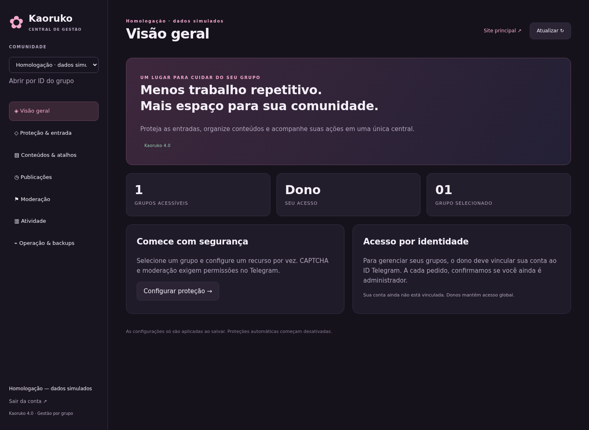

> **Versão atual: 5.0.0 — Plataforma Telegram.** Comece pelo [GUIA-5.0.md](GUIA-5.0.md). [Matriz de cobertura](docs/TELEGRAM-COBERTURA.md): fluxos prontos vs. catálogo/cliente de 185 métodos. Mini App, Stars e Business ficam desligados até configurar.
>
> Validação local: **101 testes**, tipos e interfaces Chromium com Telegram/SDK simulados. **Nenhuma cobrança, conexão Business ou nova homologação real nesta versão.** O [relatório real parcial anterior](docs/HOMOLOGACAO-REAL-PARCIAL.md) corresponde à versão 4.0.

# 🦊 Kaoruko Waguri

Bot de Telegram em ESM puro (EcmaScript Modules), persistência em SQLite via `better-sqlite3` e painel de controle web integrado via Express.

O bot conta com **329 comandos registrados e 98 aliases** divididos em categorias (diversão, downloads, logos, ia, etc.) e utiliza a **API Okarun System** para processamento de mídias, inteligência artificial e geração de imagens.

---

## 🚀 Instalação e Execução

### Requisitos
* Node.js **v20** ou superior.
* No Termux (Android) ou servidores Linux, garanta que as dependências para compilar módulos nativos estejam instaladas (necessárias para o driver do SQLite).

### Instalação rápida

1. **Clone o repositório:**
   ```bash
   git clone https://github.com/eduhdev021/kaoruko.git
   cd kaoruko
   ```

2. **Instale as dependências:**
   ```bash
   npm install
   ```

3. **Configure as credenciais:**
   Copie o arquivo de exemplo e edite com suas chaves:
   ```bash
   cp .env.example .env
   nano .env
   ```

### Execução

* **Em desenvolvimento (recarrega ao salvar arquivos):**
  ```bash
  npm run dev
  ```

* **Em produção (inicialização direta):**
  ```bash
  npm start
  ```

* **Manter rodando em produção (via PM2):**
  ```bash
  pm2 start index.js --name "kaoruko"
  ```
  *(Se você usar `/restart` no chat do bot, ele encerra o processo com código 0 e o PM2 sobe a aplicação novamente).*

---

## 📋 Configurações (.env)

Estas são as variáveis suportadas no `.env`. Os dados também podem ser lidos a partir de um arquivo `config.json` na raiz, mas o `.env` tem prioridade.

| Chave | Descrição | Onde obter |
|---|---|---|
| `BOT_TOKEN` | Token do bot do Telegram | [@BotFather](https://t.me/BotFather) |
| `OKARUN_APIKEY` | Chave da API Okarun | [Okarun System API](https://api.okarunsystem.com.br) |
| `BOT_OWNERS` | ID dos donos do bot (separados por vírgula) | [@userinfobot](https://t.me/userinfobot) |
| `PAINEL_ADMIN_EMAIL` | Email do administrador para o painel web | Defina você mesmo |
| `PAINEL_ADMIN_SENHA` | Senha inicial de acesso ao painel web | Defina você mesmo (mínimo 8 caracteres) |
| `PAINEL_PORT` | Porta usada pelo painel Express | Padrão `4091` |
| `BOT_TZ` | Fuso horário do bot | Exemplo: `America/Sao_Paulo` |

---

## 👑 Sistema VIP e Limites Diários

O controle de uso e privilégios é persistido diretamente no SQLite. O limite de comandos é zerado diariamente à meia-noite e a rotina automática limpa registros de uso e VIPs expirados às 03:00 de cada dia.

Os planos configurados em `core/vip.js` são:

| Plano | Limite Diário | Cooldown | Benefícios Adicionais |
|---|---|---|---|
| **Free** | 50 comandos | 5 segundos | Uso básico do bot |
| **Bronze** | 150 comandos | 2 segundos | Sem anúncios no rodapé |
| **Prata** | 400 comandos | 1 segundo | Downloads em fila prioritária |
| **Ouro** | 1.000 comandos | Sem cooldown | Acesso a comandos exclusivos |
| **Diamante** | Ilimitado | Sem cooldown | Suporte direto com o dono |

### Comandos Administrativos (no chat do bot)
* `/vip` — Exibe seu plano atual, histórico de transações e uso diário.
* `/addvip [id_telegram] [plano] [duração]` — Concede VIP (Ex: `/addvip 123456789 ouro 30d` ou `/addvip 123456789 diamante vitalicio`).
* `/delvip [id_telegram]` — Remove o VIP de um usuário.
* `/listvip` — Lista os VIPs ativos no sistema.

---

## 🖥️ Painel Administrativo Web

O painel é responsivo, feito com HTML5, CSS puro e JavaScript moderno no front-end, consumindo endpoints privados da API interna do Express.

### Segurança
* Senhas administrativas são armazenadas com hash **PBKDF2-SHA512** com 120.000 iterações e *salts* únicos por usuário.
* As sessões são mantidas através de cookies seguros com flag **HttpOnly** de 7 dias.
* Se houver 5 tentativas falhas seguidas no login, o IP é bloqueado temporariamente por 15 minutos.

### Gerenciamento de Contas via Chat (Dono)
Você pode criar, editar e excluir contas administrativas diretamente pelo Telegram:
```text
/conta criar [email] [senha] [id_telegram]
/conta listar
/conta senha [email] [nova_senha]
/conta vincular [email] [id_telegram]
/conta excluir [email]
```

Para permitir que qualquer usuário crie uma conta no painel web, ative a variável `PAINEL_REGISTRO_ABERTO=true` no `.env`.

---

## 🛠️ Como criar novos comandos

O bot utiliza um sistema de **autoload** inteligente de comandos baseado na estrutura de diretórios. Para criar um comando, basta adicionar um arquivo `.js` dentro da subpasta correspondente em `commands/`.

* Nome da pasta = Categoria no menu.
* Nome do arquivo = Nome do comando principal (Ex: `commands/pesquisa/clima.js` vira `/clima`).

### Estrutura básica de um comando:
```javascript
import { requisitar, acharCampo } from '../../core/api.js';
import { escapeHtml } from '../../utils/helpers.js';

export const description = 'Consulta o clima de uma cidade';
export const aliases = ['tempo'];
export const uso = '/clima Manaus';
export const cooldown = 5;

/** @param {import('../../types/index.js').CommandContext} ctx */
export default async function clima(ctx) {
  if (!ctx.q) {
    return ctx.uso(`${ctx.prefix}clima Manaus`, 'Você precisa informar a cidade.');
  }

  const carregando = await ctx.carregando('Consultando...');

  try {
    const dados = await requisitar('/api/clima', { cidade: ctx.q });
    await carregando.apagar();
    
    const temp = acharCampo(dados, ['temp']);
    await ctx.responderComApagar(`<b>${escapeHtml(ctx.q)}</b>: ${temp}°C`);
  } catch (err) {
    await carregando.apagar();
    throw err;
  }
}
```

### Propriedades disponíveis no contexto (`ctx`)
Ao rodar um comando, o parâmetro `ctx` fornece atalhos rápidos para facilitar a codificação:
* **Dados:** `ctx.q` (texto após o comando), `ctx.args` (array de argumentos), `ctx.prefix`, `ctx.userId`, `ctx.chatId`, `ctx.nome`, `ctx.username`, `ctx.isGroup`, `ctx.isPrivate`.
* **Respostas:** `ctx.responder()`, `ctx.responderComApagar()`, `ctx.erro()`, `ctx.uso()`, `ctx.carregando()`, `ctx.sendTextWithMedia()`.
* **Privilégios:** `ctx.isDono`, `ctx.isVip`, `ctx.plano` (detalhes do plano atual do usuário).

---

## 📁 Estrutura de Diretórios

```
kaoruko/
├── index.js                # Arquivo principal de boot
├── package.json            # Scripts de execução e dependências
├── .env.example            # Exemplo de configuração limpa
├── .gitignore              # Arquivos e diretórios ignorados pelo Git
├── LICENSE                 # Termos da Licença MIT
├── COPYRIGHT.md            # Declaração de Direitos Autorais
├── database/               # Pasta onde o arquivo do SQLite (.db) é criado
├── types/
│   └── index.d.ts          # Tipos JSDoc para autocompletar no VS Code
├── config/
│   └── index.js            # Arquivo que centraliza e valida configurações
├── core/                   # Núcleo de lógica do sistema (banco, api, vip, auth)
├── events/                 # Handlers de mensagens e botões interativos do Telegram
├── painel/                 # Servidor Express (front estático e endpoints de API)
├── utils/                  # Utilitários de design, texto e logs de console
└── commands/               # Pastas de comandos (autoload automático)
    ├── registry.js         # Gerencia o carregamento de todos os comandos
    ├── diversao/           # Comandos de entretenimento (72)
    ├── dono/               # Comandos administrativos de dono (10)
    ├── download/           # Módulos para baixar mídias (13)
    ├── grupo/              # Comandos para administração de grupos (2)
    ├── ia/                 # Integrações de Inteligência Artificial (8)
    ├── info/               # Status do bot e painel (6)
    ├── logos/              # Geradores de imagens de marcas e textos (146)
    └── pesquisa/           # Comandos utilitários de busca e APIs (21)
```

---

## 📜 Direitos Autorais e Licença

* **Autor / Desenvolvedor:** Eduardo Develop
* **Empresa:** Lagos Soluções
* **API Utilizada:** Okarun System API (https://api.okarunsystem.com.br)

Este software é de autoria de **Eduardo Develop**. Maiores restrições sobre uso de marcas, direitos de alteração e contato para parcerias ou licenciamentos comerciais estão detalhados no arquivo [COPYRIGHT.md](COPYRIGHT.md).

O código fonte está licenciado sob os termos da licença **MIT** (veja o arquivo [LICENSE](LICENSE)).

---
<div align="center">
  <b>Eduardo Develop • Lagos Soluções</b>
</div>

## Revisao 3.0.1

Veja `ATUALIZACOES.md` para correcoes, validacoes e limites desta revisao.
Execute `npm test` para rodar os testes com banco em memoria (sem token Telegram).
O cadastro publico sempre cria membros; configure `PAINEL_ADMIN_EMAIL` e
`PAINEL_ADMIN_SENHA` no `.env` para provisionar o administrador.


## Novidades 3.1 — Comunidade

A versao 3.1 adiciona moderacao configuravel e utilidades sem depender da API OKARUN.
Todos os comandos novos sao encontrados automaticamente no menu existente.

| Comando | Funcao |
| --- | --- |
| `/novidades` | Resumo das novidades e exemplos |
| `/buscarcmd musica` | Busca por nome, alias ou descricao |
| `/lembrete 10m beber agua` | Agenda no chat atual, mesmo apos reiniciar |
| `/lembrete listar` | Lista seus lembretes pendentes |
| `/lembrete cancelar 1` | Cancela apenas um lembrete seu |
| `/boasvindas Ola {nome}, bem-vindo ao {grupo}!` | Define boas-vindas (admin) |
| `/boasvindas off` | Desativa boas-vindas (admin) |
| `/regras` | Consulta regras |
| `/regras definir Respeite os membros` | Altera regras (admin) |
| `/regras limpar` | Remove regras (admin) |
| `/antilink on` ou `/antilink off` | Controla remocao de links (admin) |
| `/advertir` em resposta | Registra advertencia (admin) |
| `/advertir ver` ou `/advertir limpar` em resposta | Consulta ou zera advertencias (admin) |
| `/enquete Pergunta \| Sim \| Nao` | Enquete anonima nativa |
| `/configgrupo` | Configuracoes e permissoes (admin) |
| `/diagnostico` | Banco, memoria e tarefas pendentes (dono) |

### Permissoes e funcionamento
- Para o antilink, a bot precisa ser administradora com permissao de apagar mensagens.
- O Telegram precisa entregar as mensagens comuns: mantenha a bot como administradora ou ajuste `/setprivacy` no BotFather. O modo de privacidade tambem pode afetar outros comandos no grupo.
- Administradores e donos sao isentos do antilink. Links em legendas e entidades `text_link` tambem sao detectados. Nao e um filtro universal contra toda forma de URL ofuscada.
- Advertencias sao registros informativos: **nao banem automaticamente**.
- Boas-vindas aceitam `{nome}`, `{grupo}` e `{id}`. Texto e nomes sao escapados para evitar injecao de HTML.
- Lembretes aceitam de 10 segundos a 30 dias, com ate 10 pendentes por usuario. Sao enviados no chat de criacao e podem ser vistos por todos nesse chat. Use o privado para lembretes pessoais.
- A fila e consultada a cada 5 segundos, com ate 20 entregas por ciclo. Se a bot estiver desligada, entregara os vencidos quando voltar.
- Falhas temporarias sao reagendadas com limite de tentativas. Bloqueio da bot, chat invalido ou esgotamento das tentativas descartam a entrega com registro no console.
- Em caso raro de queda entre envio e confirmacao no banco, um lembrete pode ser repetido. Rode apenas uma instancia por banco para evitar concorrencia na fila.
- Contas do painel agora sao gerenciadas apenas no privado. Novos logs ocultam os argumentos desses comandos; revise logs antigos caso tenham sido gravadas senhas anteriormente.

### Docker (opcional)

Foram adicionados `Dockerfile` e `compose.yaml`. O build Docker nao foi executado neste ambiente.

```bash
cp .env.example .env
# Preencha suas credenciais e mantenha PAINEL_PORT=4091 no compose padrao.
docker compose up -d --build
docker compose logs -f
```

O banco fica em um volume persistente; o painel e exposto somente em `127.0.0.1:4091` no host.
Use um proxy HTTPS para publicar o painel. Para migrar uma instalacao existente, copie seu banco para o volume antes de iniciar; o volume novo nao importa automaticamente a pasta database do host.


## Central de Gestão 4.0

CAPTCHA e anti-raid, antispam com domínios permitidos, política de advertências, histórico/reversão, notas com mídia e botões, comandos personalizados, publicações recorrentes, reputação/níveis, gráficos, acesso por grupo e backups automáticos.

As proteções e coletas novas começam desligadas. O acesso de admins exige vínculo da conta pelo dono e confirmação do cargo no Telegram por requisição. Veja o guia antes de ativar punições.



`npm test`: suíte automatizada. `npm run test:ui`: smoke test opcional contra homologação, com variáveis e navegador conforme o guia. A restauração é feita com a bot parada: `npm run restaurar -- /caminho/backup.db`.

As seções de versões 3.x acima são histórico. Em particular, notas agora suportam mídia e avisos agora podem ter punição configurável; consulte o guia 4.0 para o comportamento atual.
